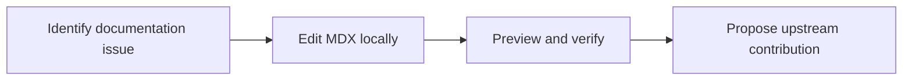

# AnythingLLM Documentation Workspace

<p align="center">
  <strong>A development copy of the AnythingLLM documentation site for learning, local testing, and documentation contribution work.</strong>
</p>

<p align="center">
  
  
  
</p>

## Overview

This repository contains documentation-site source originating from the AnythingLLM project by Mintplex Labs. It is retained as a documentation workspace and is not presented as an original Nasratul Nayem product.

## The problem

Documentation contributions need a local environment where navigation, MDX pages, components, and assets can be tested before proposing upstream changes.

## The solution

The workspace provides the Next.js documentation structure, local development commands, and contribution context needed to review or prepare documentation updates.

## What it demonstrates

- Working with an established open-source documentation codebase
- Next.js and MDX development
- Responsible upstream attribution
- Documentation-oriented contribution workflow

## Core capabilities

| Capability | Practical value |
|---|---|
| Structured documentation | Pages organized by setup, features, APIs, cloud, and agents |
| MDX content | Combines documentation with reusable components |
| Local preview | Supports review before contribution |
| Open-source workflow | Suitable for issue and pull-request based contribution |

## Workflow



## Technology

- Next.js
- TypeScript
- MDX
- React
- Yarn

## Project status

**Upstream-derived documentation workspace**

Original project and documentation belong to Mintplex Labs and the AnythingLLM contributors. Review the upstream repository and license before redistribution. This copy should remain unpinned unless it contains a meaningful, documented contribution.

## Run locally

```bash
git clone https://github.com/nasratulnayem/anythingllm-docs.git
cd anythingllm-docs
yarn
yarn dev
```

## Usage

Use the local development server to review documentation changes, then contribute appropriate improvements to the upstream project.

## Engineering notes

- Configuration and credentials should be supplied through environment variables or local files excluded from Git.
- Generated output and runtime data should not be committed.
- Claims in this README describe the capabilities visible in this repository.
- Before production deployment, review authentication, rate limits, error handling, logging, and provider terms.

## Roadmap

- [ ] Record any original documentation contributions
- [ ] Keep attribution and license information visible
- [ ] Link accepted upstream pull requests
- [ ] Archive the copy if no active contribution work remains

## About the developer

Built by **Nasratul Nayem**, a WordPress, WooCommerce, and automation developer based in Dhaka, Bangladesh.

I build practical systems that remove repetitive work: WordPress plugins, WooCommerce integrations, browser extensions, Python automation, AI-assisted content pipelines, and internal business tools.

- Portfolio: [nayem.dev](https://nayem.dev)
- GitHub: [@nasratulnayem](https://github.com/nasratulnayem)
- LinkedIn: [Nasratul Nayem](https://www.linkedin.com/in/nasratulnayem)

## License

Review the repository license before reuse. Third-party services and APIs remain subject to their own terms.
